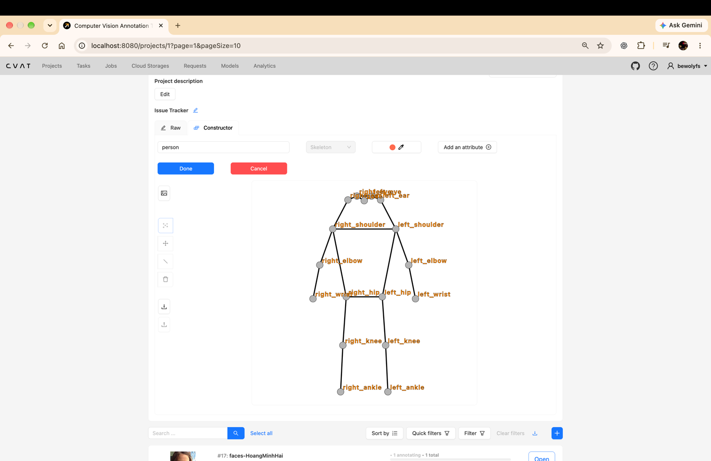
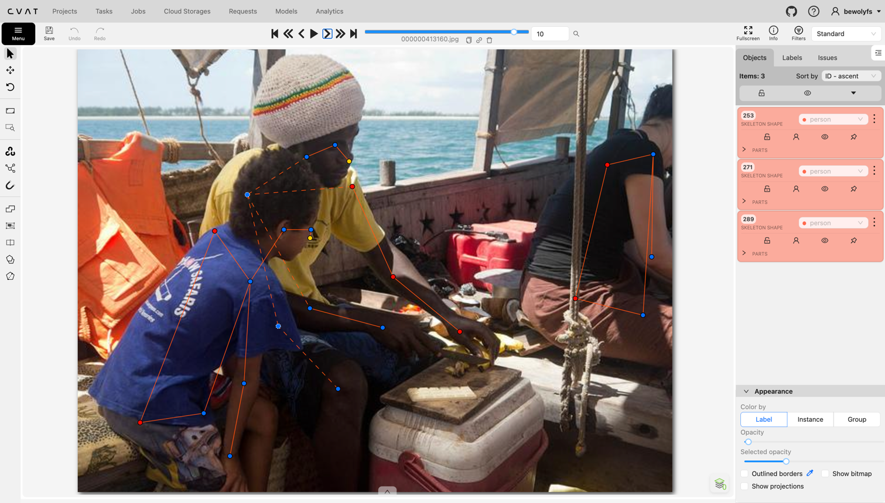
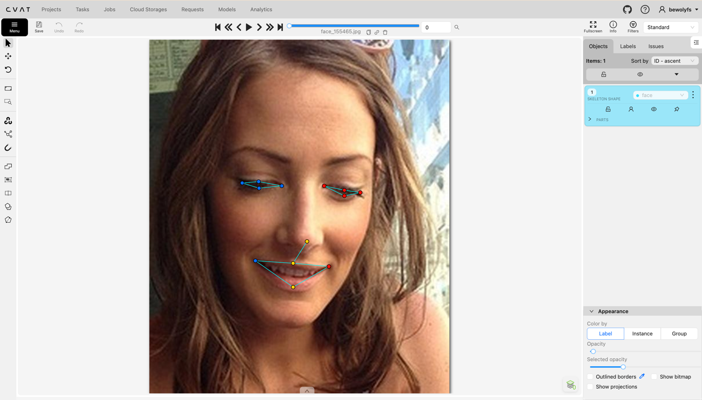

# Báo cáo cá nhân — HoangMinhHai-2A202603275

Đổi tên file theo quy tắc `MSSV_HoTen.md`. Ví dụ: `20241234_NguyenVanAn.md`.

Dữ liệu: 12 ảnh người COCO val2017 (Lin et al., 2014) và 8 ảnh chân dung Wikimedia Commons, chỉ dùng trong lớp.

## 0. Thông tin học viên

- Họ tên: Hoàng Minh Hải
- MSSV: 2A202603275
- Email:26ai.haihm@vinuni.edu.vn
- Link repository:
- Phiên bản CVAT (Help → About): 2.74.1
- Máy: hệ điều hành macOS · RAM 14 GB · chạy CVAT chế độ đầy đủ
- Bộ ảnh (`src/exports/assignment.json` do `lab.py setup` tạo): có
- Giờ bắt đầu: 16:00
- Giờ kết thúc: 19:17

## 1. Kiểm tra label (CP0)

| Label | Kiểu | Số điểm | Tên điểm đúng bảng của lab? | Đúng thứ tự? | Số cạnh |
|---|---|---:|---|---|---:|
| `person` | skeleton | 17 | Có | Có | 19 |
| `face` | skeleton | 13 | Có | Có | 13 |

Mẫu `person` dựng theo người quay mặt về camera (các điểm `left_*` nằm bên phải khung mẫu)? Có

Cách đổi cờ `occluded` / `outside` cho **một điểm** trên phiên bản CVAT này (một câu):

Trong panel Objects, mở mục **PARTS** của skeleton, rồi ở dòng của đúng điểm đó bấm biểu tượng mắt gạch chéo để bật/tắt `outside`, hoặc biểu tượng hình người để bật/tắt `occluded`.

## 2. Số lượng đã gán và thời gian (CP1, CP2)

| Nhóm ảnh | Số ảnh | Số skeleton đã gán | Số người dưới 60 px (không gán) | Số poster / gương / màn hình bỏ qua | Thời gian (phút) |
|---|---:|---:|---:|---:|---:|
| `easy` | 5 | 5 | | | |
| `occluded` | 3 | 6 | | | |
| `back` | 2 | 3 | | | |
| `small` | 1 | 1 | | | |
| `crowd` | 1 | 3 | | | |
| `faces` | 8 | 8 | — | | |

- Số ảnh người đã xong ở mốc phút 105: ___ / 10
- Thời gian thực tế (phút): CP1 ___ · CP2 ___ · CP3 ___
- Ảnh tốn thời gian nhất là ảnh nào, vì sao?

...

## 3. Bảng ca khó (CP1, CP2)

Mỗi điểm bạn phân vân một dòng, nhất là phân vân giữa `v = 1` và `v = 0`, hoặc không chắc hướng người.

| Ảnh | Người / mặt | Điểm | Cờ đã chọn | Phân vân giữa | Lý do chọn |
|---|---|---|---:|---|---|
| | | | | | |
| | | | | | |
| | | | | | |

## 4. Bảng tự review (CP3)

Đi từ ảnh cuối về ảnh đầu. 5 ảnh người (ít nhất 2 ảnh `back` hoặc `crowd`) và 3 ảnh mặt. Ít nhất 8 dòng, kể cả dòng `ok`. Ghi lỗi trước, sửa sau.

Mã lỗi dùng đúng một trong: `lr_swap`, `vis_flag`, `position`, `missing`, `extra`, `ok`.

| Ảnh | Người / mặt | Điểm | Mã lỗi | Ghi chú | Đã sửa? |
|---|---|---|---|---|---|
| | | | | | |
| | | | | | |
| | | | | | |
| | | | | | |
| | | | | | |
| | | | | | |
| | | | | | |
| | | | | | |

Tổng hợp số lỗi theo mã:

| `lr_swap` | `vis_flag` | `position` | `missing` | `extra` | `ok` |
|---:|---:|---:|---:|---:|---:|
| | | | | | |

Điểm còn phân vân giữa `v = 1` và `v = 0` (ghi cả hai lựa chọn và lý do chọn):

...

## 5. Kiểm file xuất và kết quả tự kiểm (CP4)

Tự kiểm tay trong file JSON:

| File | Người / mặt kiểm (ảnh, thứ tự) | Số phần tử `keypoints` | Điểm `outside` ra `v = 0`, `occluded` ra `v = 1`? | `num_keypoints` khớp? |
|---|---|---:|---|---|
| `HoangMinhHai_persons.zip` | `000000349521`, người 1 (người quay lưng) | 51 | Có: 5 điểm mặt `outside` ra `v = 0` | Có (12 = 12 điểm `v > 0`) |
| `HoangMinhHai_persons.zip` | `000000413160`, người 3 | 51 | Có: 12 điểm `outside` ra `v = 0` | Có (5 = 5 điểm `v > 0`) |
| `HoangMinhHai_faces.zip` | `face_405456`, mặt 1 | 39 | Có: 8 điểm `occluded` ra `v = 1` | Có (13 = 13 điểm `v > 0`) |

Sau khi xuất, CVAT ghi `occluded` thành `v = 1` và `outside` thành `v = 0`. Tọa độ của điểm `outside` trong file là `0, 0` hay tọa độ cũ? Tọa độ cũ (ví dụ mũi của người quay lưng trong `000000349521` vẫn là `90.01, 131.42` với `v = 0`).

Hai job đã chuyển sang completed trên CVAT? Có (job 15 `persons-HoangMinhHai`, job 16 `faces-HoangMinhHai`)

Dán phần **TÓM TẮT** in ra từ `src/check_submission.py`:

```text
- File person: HoangMinhHai_persons.zip
  Số ảnh: 12 · số skeleton `person`: 18 · mỗi annotation 51 số
  Skeleton theo ảnh: 000000123544=2, 000000137767=1, 000000150192=1, 000000179201=2, 000000189365=2, 000000225138=1, 000000294329=1, 000000349521=1, 000000359340=1, 000000360811=2, 000000413160=3, 000000431893=1
  Cờ v: v=2 185 (60%) · v=1 28 (9%) · v=0 93 (30%)
  num_keypoints trung bình: 11.8
- File face: HoangMinhHai_faces.zip
  Số ảnh: 8 · số skeleton `face`: 8 · mỗi annotation 39 số
  Skeleton theo ảnh: face_155465=1, face_223746=1, face_249336=1, face_405456=1, face_421231=1, face_449454=1, face_483667=1, face_559185=1
  Cờ v: v=2 94 (90%) · v=1 10 (10%) · v=0 0 (0%)
  num_keypoints trung bình: 13.0
- Ghi chú: 93 điểm v = 0 vẫn mang tọa độ cũ (CVAT 2.x xuất như vậy; chuẩn COCO ghi 0, 0). Không phải lỗi: điểm v = 0 bị bỏ qua khi huấn luyện và khi chấm.
- Số [LỖI]: 0 · số [CẢNH BÁO]: 0
Kết quả: ĐẠT
```

Các `[CẢNH BÁO]` còn giữ nguyên và lý do:

Không có (0 cảnh báo).

## 6. Ảnh chụp màn hình

1. Label `person` trong label constructor (đủ 17 điểm có tên):

   

2. Một người quay lưng đã gán, cờ đã đặt:

   

3. Một khuôn mặt đã gán 13 điểm, phóng to vùng mắt:

   

4. Một đoạn JSON xuất của một người:

   

Nguồn ảnh: COCO 2017 (`000000349521.jpg`, `face_155465.jpg` cắt từ COCO image_id 155465). Ảnh 4 là đoạn annotation của người quay lưng ở ảnh 2, lấy từ `annotations/person_keypoints_default.json` trong `HoangMinhHai_persons.zip` (tên điểm ghi bên cạnh để dễ đọc).

## 7. Tự đánh giá

1. Lỗi bạn mắc nhiều nhất hôm nay, và cách bạn sẽ tránh ở dự án thật:

   ...

2. Một quy tắc bạn đề xuất thêm vào guideline (kèm ảnh ví dụ nếu có):

   ...

3. Nhãn của bạn đi vào model ở đâu? Chọn một lỗi bạn đã sửa và nói nó sẽ làm model học sai thế nào (heatmap, trọng số trong loss, hay bước lật ảnh):

   ...

## 8. Khó khăn và lỗi kỹ thuật

...

## Bonus (nếu làm)

### B1 — 3 ảnh người khó thêm

| Ảnh | Số skeleton | Số người dưới 60 px | Ca khó nhất |
|---|---:|---:|---|
| | | | |
| | | | |
| | | | |

Kết quả `src/check_submission.py` cho `HoVaTen_bonus_persons.zip`:

```text
(dán ở đây)
```

### B2 — 5 ảnh khuôn mặt đen trắng / hồng ngoại

Ảnh không màu khó hơn ở điểm nào? Kính râm trên ảnh hồng ngoại có còn là `v = 1` không?

...

### B3 — Model so với nhãn của tôi (không tính điểm)

- Demo đã dùng:
- Ảnh đã thử:

1. Model có trả điểm cho khớp bị che, hay khớp ngoài ảnh không? Confidence ở các điểm đó thế nào?

   ...

2. Với người quay lưng, model có đổi trái/phải không?

   ...

3. Bộ điểm của model có giống 17 điểm COCO không?

   ...

## 9. Tài liệu tham khảo và công cụ AI đã dùng

- Tài liệu của lab: `README.md`, `RULES.md`, `docs/GUIDELINE.md`, `CHECKPOINTS.md`, `SUBMISSION.md`.
- Claude (Anthropic): hỏi các bước tiếp theo sau khi export; chụp 4 ảnh màn hình CVAT ở mục 6; điền các phần số liệu của báo cáo (mục 0–2, 5, 6) từ `assignment.json`, file xuất và CVAT API. Không dùng AI cho việc gán nhãn và cho mục 3, 4, 7.
