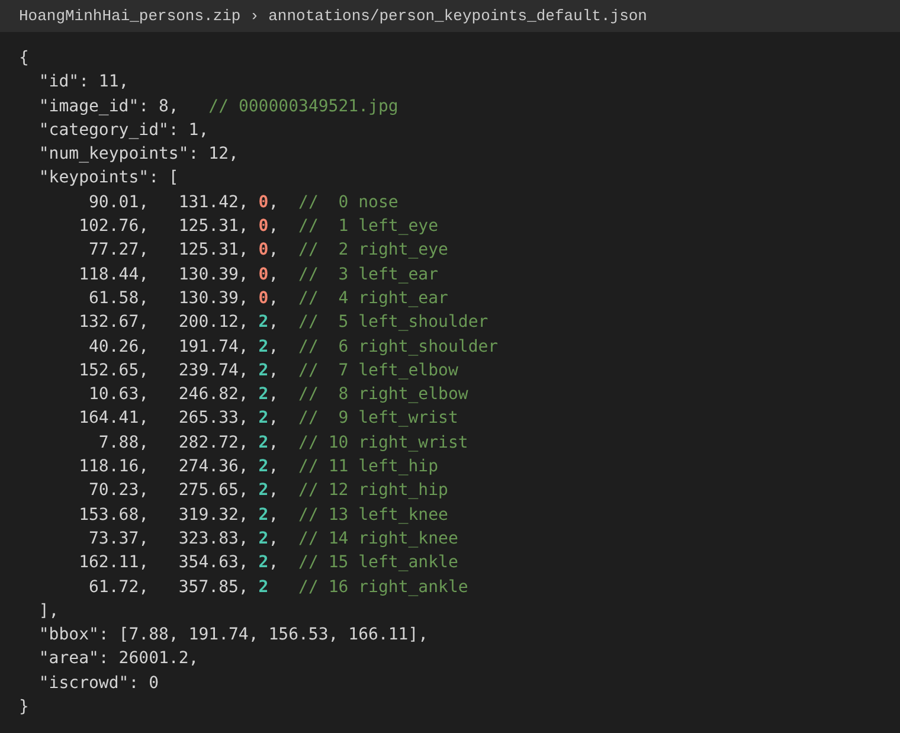

# Báo cáo cá nhân — HoangMinhHai-2A202603275

Đổi tên file theo quy tắc `MSSV_HoTen.md`. Ví dụ: `20241234_NguyenVanAn.md`.

Dữ liệu: 12 ảnh người COCO val2017 (Lin et al., 2014) và 8 ảnh chân dung Wikimedia Commons, chỉ dùng trong lớp.

## 0. Thông tin học viên

- Họ tên: Hoàng Minh Hải
- MSSV: 2A202603275
- Email:26ai.haihm@vinuni.edu.vn
- Link repository: https://github.com/abuhmhai/K5-L2-DAY04-HoangMinhHai-2A202603275-KeypointPose
- Phiên bản CVAT (Help → About): 2.74.1
- Máy: hệ điều hành macOS · RAM 14 GB · chạy CVAT chế độ đầy đủ
- Bộ ảnh (`src/exports/assignment.json` do `lab.py setup` tạo): có
- Giờ bắt đầu: 16:00
- Giờ kết thúc: 19:17

## 1. Kiểm tra label (CP0)

| Label | Kiểu | Số điểm | Tên điểm đúng bảng của lab? | Đúng thứ tự? | Số cạnh |
|---|---|---:|---|---|---:|
| `person` | skeleton | 17 | Có | Có | 19 |
| `face` | skeleton | 13 | Có | Có | 13 |

Mẫu `person` dựng theo người quay mặt về camera (các điểm `left_*` nằm bên phải khung mẫu)? Có

Cách đổi cờ `occluded` / `outside` cho **một điểm** trên phiên bản CVAT này (một câu):

Trong panel Objects, mở mục **PARTS** của skeleton, rồi ở dòng của đúng điểm đó bấm biểu tượng mắt gạch chéo để bật/tắt `outside`, hoặc biểu tượng hình người để bật/tắt `occluded`.

## 2. Số lượng đã gán và thời gian (CP1, CP2)

| Nhóm ảnh   | Số ảnh | Số skeleton đã gán | Số người dưới 60 px (không gán) | Số poster / gương / màn hình bỏ qua | Thời gian (phút) |
| ---------- | -----: | -----------------: | ------------------------------: | ----------------------------------: | ---------------: |
| `easy`     | 5      | 5                  | 0                               | 0                                   | 20               |
| `occluded` | 3      | 6                  | 0                               | 0                                   | 15               |
| `back`     | 2      | 3                  | 0                               | 0                                   | 17               |
| `small`    | 1      | 1                  | 1                               | 0                                   | 15               |
| `crowd`    | 1      | 3                  | 2                               | 0                                   | 20               |
| `faces`    | 8      | 8                  | —                               | 0                                   | 10               |

- Số ảnh người đã xong ở mốc phút 105: 6 / 10
- Thời gian thực tế (phút): CP1 135 · CP2 30 · CP3 25
- Ảnh tốn thời gian nhất là ảnh nào, vì sao?

Ảnh `000000413160.jpg` (nhóm `crowd`): phải tách 3 người gần nhau, nhiều khớp bị che hoặc cắt khung, dễ kéo xương sang người khác và phải đặt nhiều cờ `outside` / `occluded`.

## 3. Bảng ca khó (CP1, CP2)

Mỗi điểm bạn phân vân một dòng, nhất là phân vân giữa `v = 1` và `v = 0`, hoặc không chắc hướng người.

| Ảnh            | Người / mặt                     | Điểm                               | Cờ đã chọn           | Phân vân giữa     | Lý do chọn                                                                                        |
| -------------- | ------------------------------- | ---------------------------------- | -------------------: | ----------------- | ------------------------------------------------------------------------------------------------- |
| `000000123544` | người 1 (mũ bảo hiểm, trái ảnh) | `right_ear`                        | `occluded` (`v = 1`) | `v = 1` / `v = 0` | Tai bị mũ che nhưng vị trí vẫn ước được theo vành mũ và hướng đầu → chọn `occluded`.              |
| `000000123544` | người 1                         | `left_eye`, `left_ear`             | `outside` (`v = 0`)  | `v = 1` / `v = 0` | Bên đầu khuất hoàn toàn, không xác định chắc → `outside`, không đoán.                             |
| `000000137767` | người 1                         | `left_eye`, `right_eye`            | `occluded` (`v = 1`) | `v = 1` / `v = 0` | Mắt sau kính râm vẫn thấy hình dạng mắt qua kính → `occluded`, không `outside`.                   |
| `000000349521` | người 1 (quay lưng)             | `nose`, hai mắt, hai tai           | `outside` (`v = 0`)  | `v = 1` / `v = 0` | Quay lưng, mặt không thấy; không đoán vị trí mặt từ sau đầu → cả cụm mặt `outside`.               |
| `000000360811` | người 2 (cầm chai)              | `left_wrist`, `right_wrist`        | `outside` (`v = 0`)  | `v = 2` / `v = 0` | Phân vân vì bàn tay cầm chai nhìn thấy một phần; vẫn để `outside` khi không chắc đúng khớp cổ tay |
| `000000413160` | người 3                         | nhiều khớp thân dưới               | `outside` (`v = 0`)  | `v = 1` / `v = 0` | Chỉ lộ rõ phần trên; gối/cổ chân bị cắt hoặc che chắc → `outside` thay vì đoán.                   |
| `face_405456`  | mặt 1                           | 8 điểm mắt                         | `occluded` (`v = 1`) | `v = 1` / `v = 0` | Kính râm che mắt nhưng vị trí mí/khóe vẫn ước được theo khung kính → `occluded`.                  |
| `face_483667`  | mặt 1                           | `left_eye_outer`, `left_eye_upper` | `occluded` (`v = 1`) | `v = 1` / `v = 0` | Tóc che một phần mắt trái nhưng vẫn đoán được mép mắt → `occluded`.                               |

## 4. Bảng tự review (CP3)

Đi từ ảnh cuối về ảnh đầu. 5 ảnh người (ít nhất 2 ảnh `back` hoặc `crowd`) và 3 ảnh mặt. Ít nhất 8 dòng, kể cả dòng `ok`. Ghi lỗi trước, sửa sau.

Mã lỗi dùng đúng một trong: `lr_swap`, `vis_flag`, `position`, `missing`, `extra`, `ok`.

| Ảnh | Người / mặt | Điểm | Mã lỗi | Ghi chú | Đã sửa? |
|---|---|---|---|---|---|
| `000000413160` | người 3 | — | `ok` | Crowd, 3 skeleton tách đúng người; cờ `outside` khớp phần bị cắt khung. | — |
| `000000360811` | người 2 | `left_wrist`, `right_wrist` | `vis_flag` | Hai cổ tay đang `outside` trong khi bàn tay cầm chai nhìn thấy một phần; đã ghi nhận khi review. | Chưa (ZIP vẫn `v = 0`) |
| `000000359340` | người 1 | mặt / `right_wrist` | `ok` | Người quay lưng: cụm mặt `outside`; không thấy skeleton thừa trên poster. | — |
| `000000123544` | người 2 (áo số 23, quay lưng) | cặp `left_*` / `right_*` | `lr_swap` | Lần đầu mẫu còn hướng chính diện nên trái/phải lệch; nói to hướng người rồi kéo lại theo lưng. | Có |
| `000000150192` | skeleton phụ (~41 px) | — | `extra` | Script cảnh báo chiều cao điểm < 60 px; đo lại người thật dưới ngưỡng → xóa skeleton. | Có |
| `000000349521` | người 1 | cụm mặt | `vis_flag` | Kiểm lại: quay lưng thì mũi/mắt/tai phải `outside`, không để `occluded`. | Có |
| `face_405456` | mặt 1 | 8 điểm mắt | `ok` | Kính râm: đủ 8 điểm mắt ở `occluded` (`v = 1`), mũi/miệng `v = 2`. | — |
| `face_483667` | mặt 1 | `left_eye_outer`, `left_eye_upper` | `ok` | Tóc che một phần mắt trái đã đặt `occluded`; các điểm còn lại rõ. | — |
| `face_155465` | mặt 1 | — | `ok` | 13 điểm `v = 2`, trái/phải theo người trong ảnh. | — |

Tổng hợp số lỗi theo mã:

| `lr_swap` | `vis_flag` | `position` | `missing` | `extra` | `ok` |
|---:|---:|---:|---:|---:|---:|
| 1 | 2 | 0 | 0 | 1 | 5 |

Điểm còn phân vân giữa `v = 1` và `v = 0` (ghi cả hai lựa chọn và lý do chọn):

- `000000123544` người 1, `right_ear`: chọn `v = 1` (mũ che nhưng ước được) thay vì `v = 0`.
- `face_405456`, 8 điểm mắt sau kính: chọn `v = 1` vì vẫn ước vị trí mí/khóe; nếu kính phản quang hoàn toàn không thấy mắt thì mới cân nhắc `v = 0`.

## 5. Kiểm file xuất và kết quả tự kiểm (CP4)

Tự kiểm tay trong file JSON:

| File | Người / mặt kiểm (ảnh, thứ tự) | Số phần tử `keypoints` | Điểm `outside` ra `v = 0`, `occluded` ra `v = 1`? | `num_keypoints` khớp? |
|---|---|---:|---|---|
| `HoangMinhHai_persons.zip` | `000000349521`, người 1 (người quay lưng) | 51 | Có: 5 điểm mặt `outside` ra `v = 0` | Có (12 = 12 điểm `v > 0`) |
| `HoangMinhHai_persons.zip` | `000000413160`, người 3 | 51 | Có: 12 điểm `outside` ra `v = 0` | Có (5 = 5 điểm `v > 0`) |
| `HoangMinhHai_faces.zip` | `face_405456`, mặt 1 | 39 | Có: 8 điểm `occluded` ra `v = 1` | Có (13 = 13 điểm `v > 0`) |

Sau khi xuất, CVAT ghi `occluded` thành `v = 1` và `outside` thành `v = 0`. Tọa độ của điểm `outside` trong file là `0, 0` hay tọa độ cũ? Tọa độ cũ (ví dụ mũi của người quay lưng trong `000000349521` vẫn là `90.01, 131.42` với `v = 0`).

Hai job đã chuyển sang completed trên CVAT? Có (job 15 `persons-HoangMinhHai`, job 16 `faces-HoangMinhHai`)

Dán phần **TÓM TẮT** in ra từ `src/check_submission.py`:

```text
- File person: HoangMinhHai_persons.zip
  Số ảnh: 12 · số skeleton `person`: 18 · mỗi annotation 51 số
  Skeleton theo ảnh: 000000123544=2, 000000137767=1, 000000150192=1, 000000179201=2, 000000189365=2, 000000225138=1, 000000294329=1, 000000349521=1, 000000359340=1, 000000360811=2, 000000413160=3, 000000431893=1
  Cờ v: v=2 185 (60%) · v=1 28 (9%) · v=0 93 (30%)
  num_keypoints trung bình: 11.8
- File face: HoangMinhHai_faces.zip
  Số ảnh: 8 · số skeleton `face`: 8 · mỗi annotation 39 số
  Skeleton theo ảnh: face_155465=1, face_223746=1, face_249336=1, face_405456=1, face_421231=1, face_449454=1, face_483667=1, face_559185=1
  Cờ v: v=2 94 (90%) · v=1 10 (10%) · v=0 0 (0%)
  num_keypoints trung bình: 13.0
- Ghi chú: 93 điểm v = 0 vẫn mang tọa độ cũ (CVAT 2.x xuất như vậy; chuẩn COCO ghi 0, 0). Không phải lỗi: điểm v = 0 bị bỏ qua khi huấn luyện và khi chấm.
- Số [LỖI]: 0 · số [CẢNH BÁO]: 0
Kết quả: ĐẠT
```

Các `[CẢNH BÁO]` còn giữ nguyên và lý do:

Không có (0 cảnh báo).

## 6. Ảnh chụp màn hình

1. Label `person` trong label constructor (đủ 17 điểm có tên):

   
2. Một người quay lưng đã gán, cờ đã đặt:

   
3. Một khuôn mặt đã gán 13 điểm, phóng to vùng mắt:

   
4. Một đoạn JSON xuất của một người:

   

Nguồn ảnh: COCO 2017 (`000000349521.jpg`, `face_155465.jpg` cắt từ COCO image_id 155465). Ảnh 4 là đoạn annotation của người quay lưng ở ảnh 2, lấy từ `annotations/person_keypoints_default.json` trong `HoangMinhHai_persons.zip` (tên điểm ghi bên cạnh để dễ đọc).

## 7. Tự đánh giá

1. Lỗi bạn mắc nhiều nhất hôm nay, và cách bạn sẽ tránh ở dự án thật:

   Đặt sai cờ visibility (`vis_flag`), đặc biệt lúc phân vân giữa `occluded` và `outside`, và lúc vội đánh `outside` cho khớp vẫn nhìn thấy (ví dụ cổ tay cầm chai). Ở dự án thật sẽ làm checklist sau mỗi ảnh: điểm nhìn thấy rõ → `v = 2`; bị che nhưng ước chắc → `v = 1`; không thấy / ngoài khung → `v = 0`; không dùng phím ẩn điểm thay cho cờ.
2. Một quy tắc bạn đề xuất thêm vào guideline (kèm ảnh ví dụ nếu có):

   Với người quay lưng: luôn đặt cả cụm mặt (`nose`, hai mắt, hai tai) thành `outside` trừ khi thật sự thấy nghiêng mặt; đừng để mẫu chính diện kéo mũi/mắt vào sau đầu. Ví dụ đã gặp: `000000349521.jpg` (ảnh chụp mục 6).
3. Nhãn của bạn đi vào model ở đâu? Chọn một lỗi bạn đã sửa và nói nó sẽ làm model học sai thế nào (heatmap, trọng số trong loss, hay bước lật ảnh):

   Lỗi `lr_swap` trên người áo số 23 quay lưng (`000000123544`): nếu nộp khi `left_*` / `right_*` bị đổi, heatmap vẫn được huấn luyện quanh đúng khớp nhưng gắn sai tên; khi augment lật ảnh, pipeline đổi tên trái/phải theo quy ước COCO sẽ nhân đôi lỗi, OKS khi chấm sụp dù vị trí điểm nhìn “đúng khớp”.

## 8. Khó khăn và lỗi kỹ thuật

- Lần export đầu có `[CẢNH BÁO]` trên `000000150192.jpg` (điểm chỉ trải cao 41 px): đã xóa skeleton người dưới 60 px rồi export lại → 0 cảnh báo.
- CVAT 2.x xuất điểm `v = 0` vẫn giữ tọa độ cũ (không về `0, 0`); script ghi chú rõ, không phải lỗi cần sửa JSON tay.
- Mất quyền điều khiển trình duyệt/máy tính giữa chừng khi nhờ AI hỗ trợ thao tác CVAT; phải bật lại plugin rồi làm tiếp phần face và rà person.
- `lab.py` lần đầu báo lỗi đường dẫn CVAT cũ sau khi sửa Nuclio; chạy lại với tùy chọn bỏ qua ghi cấu hình thư mục cũ thì hết.

## Bonus (nếu làm)

Không làm bonus B1–B3 trong buổi này.

## 9. Tài liệu tham khảo và công cụ AI đã dùng

- Tài liệu của lab: `README.md`, `RULES.md`, `docs/GUIDELINE.md`, `CHECKPOINTS.md`, `SUBMISSION.md`.
- ChatGPT: hướng dẫn setup CVAT/`lab.py`, hỗ trợ thao tác gán một số ảnh trên CVAT (person và face), giải thích cảnh báo khi export, hướng dẫn chụp 4 ảnh minh chứng.
- Cursor (Composer): đối chiếu `assignment.json` + file ZIP xuất để điền nốt mục 2–4, 7–8 của báo cáo; cập nhật mục 9 cho khớp mức hỗ trợ AI thực tế.
